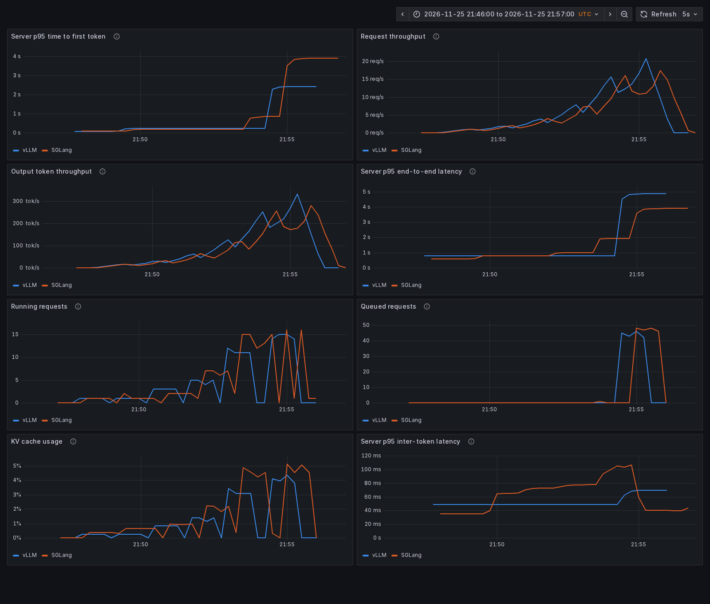
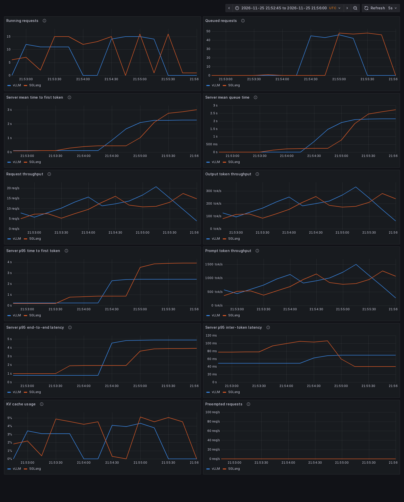

# vLLM and SGLang on Modal A10s with live Grafana, 2026-11-25

Repeated the November 24 six-rate GuideLLM sweep on both engines at the same time, each on its own A10, with Prometheus scraping both servers into one live Grafana dashboard. The client moved from the Raspberry Pi to a Modal CPU container in the same region as the GPUs.

The capacity results match November 24. vLLM held the 500 ms p95 TTFT target through 16 req/s and SGLang through 8 req/s. Both engines completed every offered request up to 16 req/s and hit their 16-running-request limit at 32 req/s. With the client next to the GPUs, SGLang's low-load client TTFT fell from 268 ms to 77 ms p95, while vLLM's stayed near 164 ms.

## Setup

| Item | Value |
|---|---|
| Engines | vLLM 0.21.0 and SGLang 0.5.9, one Modal NVIDIA A10 (24 GB) each, us-east |
| Launchers | [`vllm_qwen3_8b.py`](../../deploy/modal/vllm_qwen3_8b.py) and [`sglang_qwen3_8b.py`](../../deploy/modal/sglang_qwen3_8b.py), default `A10` profile |
| Engine limits | BF16, 8,192-token context, 16 running requests, CUDA graphs off (`--enforce-eager` / `--disable-cuda-graph`), prefix caching on. vLLM reserves 90% of GPU memory, SGLang 85% static |
| Model | `Qwen/Qwen3-8B` at `b968826d9c46dd6066d109eabc6255188de91218`, served as `qwen3-8b` |
| Client | GuideLLM 0.8.1 in an 8-CPU Modal container pinned to us-east, run by [`guidellm_modal.py`](../guidellm_modal.py) with `--plan a10-rate`. One client per engine, started together |
| Workload | Streaming `/v1/chat/completions`, synthetic text, seed 42, 64 configured prompt tokens (72 after chat formatting) and 16 output tokens |
| Stages | Three sequential warm-up requests, then constant 1, 2, 4, 8, 16 and 32 req/s for 60 s each with a 5 s warm-up. In-flight cap 4 below 8 req/s, 64 from 8 req/s |
| Server metrics | Prometheus scraping both `/metrics` endpoints every 5 s, shown in the [live dashboard](../../observability/README.md#live-engine-comparison) |

## Client results

Completed req/s is completed requests divided by the measured duration. Both engines reported zero request errors at every rate, and both warm-up stages completed 3 of 3 requests.

| Target req/s | vLLM / SGLang completed req/s | vLLM / SGLang p95 TTFT (ms) | vLLM / SGLang p50 TTFT (ms) | vLLM / SGLang p50 ITL (ms) | vLLM / SGLang incomplete |
|---:|---:|---:|---:|---:|---:|
| 1 | 1.00 / 1.00 | 163.6 / 77.2 | 161.2 / 69.1 | 33.6 / 33.6 | 1 / 1 |
| 2 | 2.00 / 2.00 | 224.0 / 120.9 | 207.0 / 103.7 | 34.6 / 37.5 | 2 / 2 |
| 4 | 4.02 / 4.00 | 232.1 / 123.1 | 214.8 / 104.6 | 37.7 / 42.8 | 3 / 3 |
| 8 | 8.02 / 7.98 | 232.5 / 125.5 | 216.0 / 106.0 | 38.7 / 54.5 | 6 / 8 |
| 16 | 16.02 / 16.02 | 244.0 / 832.9 | 226.3 / 445.5 | 41.6 / 46.5 | 13 / 17 |
| 32 | 20.80 / 17.44 | 2,482.4 / 3,141.6 | 2,396.6 / 3,063.3 | 44.9 / 38.2 | 63 / 64 |

At 32 req/s both clients reached their 64-request in-flight cap, with p95 root dispatch delay of 18.7 s for vLLM and 24.1 s for SGLang. The client could not send at the nominal rate, so this stage measures each engine under saturation rather than at 32 req/s.

## Server metrics

The dashboard shows what the client cannot. Peaks below come from the 5-second Prometheus samples; the dashboard thins points at full-sweep zoom and can hide the highest one.

- Running requests reached the 16-request limit on both engines at 32 req/s. SGLang's batch also filled during the 16 req/s stage, which explains its 833 ms p95 TTFT there, while its sampled queue peaked at only 2 requests. November 24 sampled 12 waiting at the same rate.
- Queued requests were zero on both engines through 8 req/s and zero on vLLM at 16 req/s. At 32 req/s the queue peaked at 46 requests on vLLM and 60 on SGLang.
- KV cache usage peaked at 4.6% on vLLM and 5.1% on SGLang, because each request holds only 88 tokens. The run was limited by the running-request cap, not by memory.

The 16 and 32 req/s stages, zoomed in on the later 12-panel version of the dashboard. At 32 req/s both batches are full at 16, and mean queue time rises to about 2.1 s on vLLM and 2.7 s on SGLang, most of their server-side TTFT. On the A10, unlike the [H100 run](../2026-11-25-modal-h100-concurrency/README.md), the scheduler queue explains the latency.

Mean server-side TTFT, computed from the histogram sum and count over a rolling minute, stayed between 45 and 112 ms for vLLM through 16 req/s and between 54 and 101 ms for SGLang through 8 req/s. SGLang's mean rose to about 0.45 s at 16 req/s. At 32 req/s the means reached about 2.3 s on vLLM and 3.0 s on SGLang. The dashboard's p95 TTFT panel shows vLLM near 0.25 s at low load because vLLM's histogram has no bucket between 0.1 and 0.25 s, so `histogram_quantile` interpolates inside that gap. The means are the reliable server-side figure here.

## Comparison with November 24

| Target req/s | p95 TTFT vLLM, Nov 24 → Nov 25 (ms) | p95 TTFT SGLang, Nov 24 → Nov 25 (ms) |
|---:|---:|---:|
| 1 | 172.0 → 163.6 | 267.8 → 77.2 |
| 2 | 221.8 → 224.0 | 312.0 → 120.9 |
| 4 | 226.7 → 232.1 | 317.1 → 123.1 |
| 8 | 295.8 → 232.5 | 317.5 → 125.5 |
| 16 | 307.2 → 244.0 | 1,183.0 → 832.9 |
| 32 | 2,514.6 → 2,482.4 | 3,275.6 → 3,141.6 |

Completed throughput at 32 req/s was 20.64 → 20.80 req/s for vLLM and 17.14 → 17.44 req/s for SGLang. The highest rate under 500 ms p95 TTFT is unchanged: 16 req/s for vLLM and 8 req/s for SGLang.

Moving the client next to the GPUs cut SGLang's low-load TTFT by about 190 ms, but vLLM's by under 10 ms. Server-side TTFT is similar on both engines at low load, so the remaining 90 to 100 ms that vLLM's client sees is outside the engine's own measurement: in the streaming response path, Modal's proxy, or how each server flushes its first chunk. The cause is not yet established. Compare client TTFT between these engines only from the same client location.

## Caveats

- The two clients started together but drifted apart: each SGLang stage began 10 to 33 s after the matching vLLM stage. Every stage still received the same offered load for the same duration, but the dashboard's time axes are offset by that amount.
- The engines ran in eager mode with a 16-request limit, kept for comparability with earlier runs. These results do not show either engine's CUDA-graph performance.
- p99 and confidence intervals are not reported. At 1 and 2 req/s GuideLLM had too few samples for them.

## Raw data

GuideLLM reports are in [`raw/`](raw/), one file per stage under `20261125-a10-live-vllm/` and `20261125-a10-live-sglang/`, with the endpoint hostname replaced by `MODAL_HOST`.
