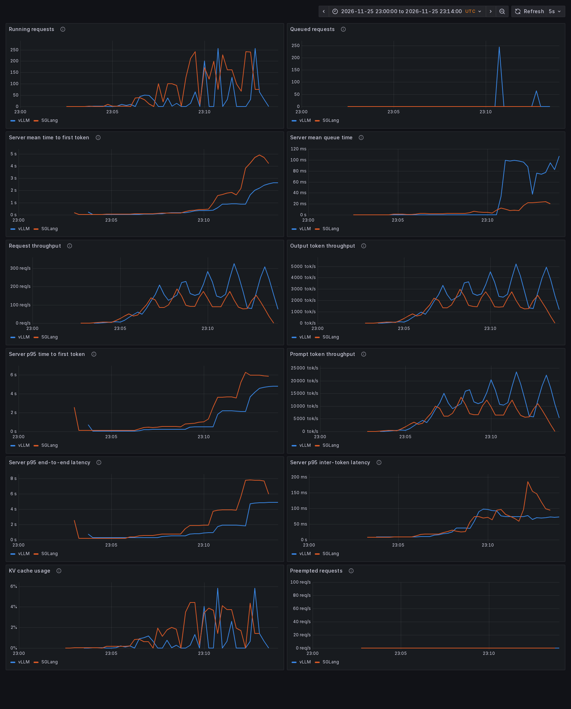
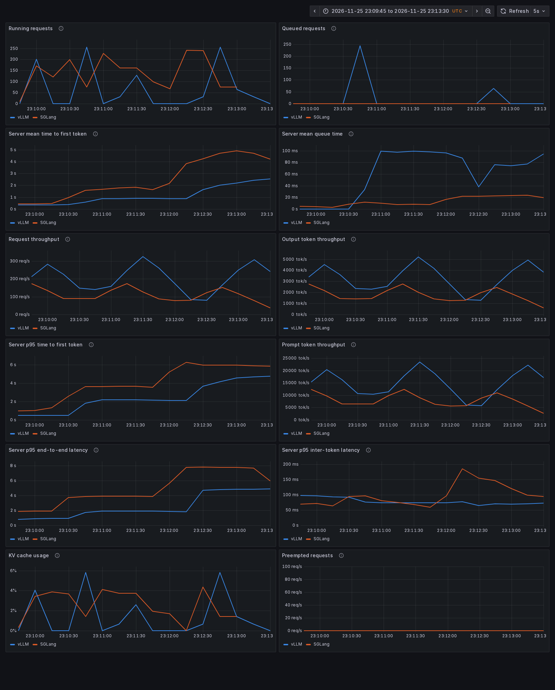

# vLLM and SGLang to 1,000 concurrent requests on Modal H100s, 2026-11-25

A GuideLLM concurrency sweep from 1 to 1,000 concurrent streaming requests, on vLLM and SGLang at the same time, each on its own H100 with CUDA graphs and a 256-request batch limit. Prometheus scraped both servers into the live Grafana dashboard throughout.

Both engines completed every stage, including 1,000 concurrent, with zero request errors. vLLM peaked at 327 completed req/s at 500 concurrent and held 307 req/s at 1,000. SGLang peaked at 185 req/s at 100 concurrent and fell to 143 req/s at 1,000. Above 250 concurrent, most of each engine's time to first token was spent before its scheduler queue, not waiting for a batch slot.

## Setup

| Item | Value |
|---|---|
| Engines | vLLM 0.21.0 and SGLang 0.5.9, one Modal NVIDIA H100 each, us-east |
| Launchers | [`vllm_qwen3_8b.py`](../../deploy/modal/vllm_qwen3_8b.py) and [`sglang_qwen3_8b.py`](../../deploy/modal/sglang_qwen3_8b.py) with `GPU_PROFILE=H100` |
| Engine limits | BF16, 8,192-token context, 256 running requests, CUDA graphs on (SGLang `--cuda-graph-max-bs 256`), prefix caching on. vLLM reserves 90% of GPU memory, SGLang 85% static |
| Model | `Qwen/Qwen3-8B` at `b968826d9c46dd6066d109eabc6255188de91218`, served as `qwen3-8b` |
| Client | GuideLLM 0.8.1 in a 16-CPU Modal container pinned to us-east, run by [`guidellm_modal.py`](../guidellm_modal.py) with `--plan h100-concurrency`. One client per engine, started together. 120 s request timeout |
| Workload | Streaming `/v1/chat/completions`, synthetic text, seed 42, 64 configured prompt tokens (72 after chat formatting) and 16 output tokens |
| Stages | Three sequential warm-up requests, then 1, 10, 50, 100, 250, 500 and 1,000 concurrent streams for 60 s each with a 5 s warm-up |

A 30-second dry run at 10 and 250 concurrent checked the profile and client first. The engines ran about 13 minutes each for the sweep and 6 minutes each for the dry run, roughly 2.50 USD of H100 time in total.

## Client results

Completed req/s is completed requests divided by the measured duration. Both engines reported zero request errors at every stage. Incomplete counts are the requests still in flight at each stage's cutoff, which for a concurrency profile is close to the concurrency itself.

| Concurrent | vLLM / SGLang completed req/s | vLLM / SGLang p50 TTFT (ms) | vLLM / SGLang p95 TTFT (ms) | vLLM / SGLang p50 ITL (ms) | vLLM / SGLang p95 request latency (s) |
|---:|---:|---:|---:|---:|---:|
| 1 | 6.9 / 6.5 | 41 / 48 | 44 / 52 | 6.6 / 6.7 | 0.14 / 0.15 |
| 10 | 61.1 / 51.7 | 55 / 75 | 65 / 92 | 7.0 / 7.1 | 0.17 / 0.20 |
| 50 | 204.7 / 144.0 | 107 / 128 | 154 / 486 | 8.0 / 8.9 | 0.28 / 0.66 |
| 100 | 247.1 / 184.8 | 221 / 190 | 277 / 641 | 10.6 / 12.1 | 0.42 / 0.88 |
| 250 | 280.4 / 176.2 | 463 / 833 | 602 / 1,234 | 26.1 / 30.2 | 0.96 / 1.92 |
| 500 | 326.6 / 168.2 | 1,073 / 2,218 | 1,303 / 3,083 | 31.6 / 32.3 | 1.80 / 3.76 |
| 1,000 | 306.8 / 143.4 | 2,724 / 5,598 | 3,328 / 11,137 | 33.1 / 49.3 | 3.87 / 12.92 |

Against the project's 500 ms p95 TTFT target, vLLM passed through 100 concurrent and SGLang through 50 concurrent.

## Server metrics

From the 5-second Prometheus samples within each stage. Queue time and TTFT are means over the stage (histogram sum / count).

| Concurrent | vLLM running / queued peak | SGLang running / queued peak | vLLM / SGLang mean queue time | vLLM / SGLang mean server TTFT |
|---:|---:|---:|---:|---:|
| 1 | 1 / 0 | 1 / 0 | 0.02 / 0.2 ms | 17 / 26 ms |
| 10 | 10 / 0 | 10 / 0 | 0.01 / 0.9 ms | 29 / 50 ms |
| 50 | 50 / 0 | 50 / 0 | 0.04 / 2.1 ms | 73 / 99 ms |
| 100 | 100 / 0 | 134 / 0 | 0.07 / 2.4 ms | 165 / 151 ms |
| 250 | 250 / 0 | 242 / 0 | 0.13 / 4.4 ms | 359 / 445 ms |
| 500 | 256 / 244 | 251 / 0 | 104 / 8 ms | 909 / 1,799 ms |
| 1,000 | 256 / 128 | 245 / 18 | 83 / 22 ms | 2,503 / 4,806 ms |

SGLang's sampled running count reached 134 during the 100-concurrent stage, above the client's 100 in-flight requests. The cause was not investigated.

Neither engine preempted or retracted a request at any stage, and KV cache usage peaked at 5.8% on vLLM and 4.9% on SGLang. With 88-token requests, memory was never the limit.

The 500 and 1,000 concurrent stages, zoomed in. vLLM's batch sits at 256 with up to 244 queued, while its mean queue time stays near 0.1 s and mean server TTFT climbs to 2.5 s. SGLang never queues, yet its server TTFT reaches 4.8 s.

## What limited each engine

vLLM filled its 256-request batch from 500 concurrent and queued up to 244 more in its scheduler. Its throughput stopped growing there, at 327 req/s, and fell slightly at 1,000.

At 500 and 1,000 concurrent, the scheduler queue explains little of either engine's TTFT. vLLM's mean queue time was about 0.1 s against a mean server TTFT of 0.9 to 2.5 s. SGLang's was under 25 ms against 1.8 to 4.8 s, and its batch never filled: it peaked at 251 running with at most 18 queued. At 1,000 concurrent the engines' own counters held at most about 384 (vLLM) and 263 (SGLang) of the 1,000 in-flight requests. The rest were between the client and the scheduler: in Modal's proxy, the HTTP server, or tokenization. This run does not show which. Per-stage timing inside each server would be needed to separate them.

The client was not the limit for vLLM: its p95 root dispatch delay stayed at or below 0.10 s, under GuideLLM's 0.2 s lateness threshold. For SGLang it was 0.26 s at 250 concurrent and 0.41 s at 1,000, so some SGLang requests started late at those stages. Because the client could reach 327 req/s against vLLM with the same configuration, this is more likely backpressure from SGLang's slower responses than a client limit.

## Caveats

- One run per engine, on one container each. Treat differences of a few percent as noise.
- The workload is short: 72 prompt and 16 output tokens. It stresses scheduling and request handling more than prefill or decode, and results for long prompts or outputs will differ.
- The two clients drifted apart by up to 40 s per stage. Every stage still ran for the same duration, but the dashboard's time axes are offset.
- The engine memory settings differ by design (vLLM 90% utilization, SGLang 85% static). KV cache was nearly empty throughout, so this did not affect these results.
- At 1 concurrent, vLLM and SGLang client TTFT differed by 7 ms. The 90 to 100 ms low-load gap seen on the [A10 run](../2026-11-25-modal-a10-live/README.md) does not appear with CUDA graphs on the H100.

## Raw data

GuideLLM reports are in [`raw/`](raw/), one gzip-compressed JSON file per stage under `20261125-h100-vllm/` and `20261125-h100-sglang/`, with the endpoint hostname replaced by `MODAL_HOST`. Read one with `gzip -dc raw/20261125-h100-vllm/c1000.json.gz | python3 -m json.tool | less`.
