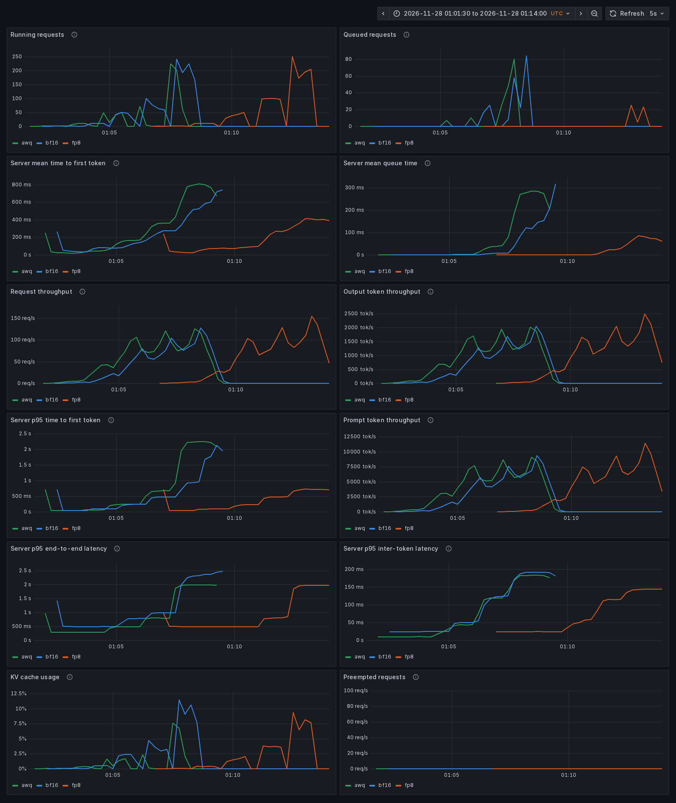

# Qwen3-8B in BF16, FP8 and AWQ INT4 on Modal L40S GPUs, 2026-11-28

The Week 6 quantization comparison. Qwen's own BF16, FP8 and AWQ (INT4 weight) checkpoints, each served by vLLM on its own L40S, measured for quality, memory and throughput.

**FP8 matched BF16 on quality and served 9 to 21% more requests at 250 concurrent across two runs. AWQ lost a statistically significant 2 points of GSM8K accuracy and 5% in WikiText perplexity. It was the fastest variant at low load, but no faster than BF16 at 250 concurrent.** FP8 is the better default here; AWQ is a memory and single-stream-latency lever, not a throughput one.



## Setup

| Item | Value |
|---|---|
| Checkpoints | `Qwen/Qwen3-8B` @ `b968826` (BF16), `Qwen/Qwen3-8B-FP8` @ `220b46e` (block-wise FP8 weights and activations), `Qwen/Qwen3-8B-AWQ` @ `4da05a8` (4-bit AWQ weights, 16-bit activations) |
| Engine | vLLM 0.21.0, [`vllm_qwen3_8b.py`](../../deploy/modal/vllm_qwen3_8b.py) with `GPU_PROFILE=L40S` and `MODEL_VARIANT=bf16\|fp8\|awq` |
| Engine limits | 8,192-token context, 256 running requests, CUDA graphs, 90% GPU memory, prefix caching on, KV cache in BF16 for every variant, served as `qwen3-8b` |
| Kernels | FP8: block FP8 W8A8 (vLLM logged no tuned config for the L40S: "Performance might be sub-optimal"). AWQ: `awq_marlin` |
| GPU | One NVIDIA L40S (48 GB, Ada) per variant, pinned to us-east |
| Quality client | lm-evaluation-harness 0.4.13 `local-completions` against `/v1/completions` from a Modal CPU container ([`lm_eval_modal.py`](../lm_eval_modal.py)) |
| Throughput client | GuideLLM 0.8.1 `quant-concurrency` plan from a Modal CPU container in us-east ([`guidellm_modal.py`](../guidellm_modal.py)): 1, 10, 50, 100, 250 concurrent, 60 s each, 72 prompt / 16 output tokens |
| Server metrics | Prometheus scraping each engine every 5 s, [variants dashboard](../../observability/quant-grafana.json) |

## Quality

Full GSM8K test set (1,319 questions, 5-shot, greedy) and WikiText-2 document-level perplexity (62 documents, rolling 2,047-token windows).

| | BF16 | FP8 | AWQ INT4 |
|---|---:|---:|---:|
| GSM8K exact match, strict | 87.6% ± 0.9 | 88.0% ± 0.9 | **85.6% ± 1.0** |
| GSM8K exact match, flexible extract | 88.1% | 88.1% | 86.1% |
| Change vs BF16 (strict), paired test | | +0.4 pt, p = 0.58 | **−2.0 pt, p = 0.017** |
| WikiText word perplexity | 13.48 | 13.53 (+0.3%) | **14.15 (+5.0%)** |
| WikiText bits per byte | 0.7019 | 0.7027 (+0.1%) | 0.7149 (+1.9%) |

Every variant answered the same questions, so the comparison is paired (McNemar). FP8 and BF16 disagreed on 53 questions, 29 to 24 in FP8's favour: no detectable difference. AWQ and BF16 disagreed on 119, 73 to 46 in BF16's favour: a real loss. The roadmap's rule of thumb is to keep 16-bit or FP8 as the default when INT4 costs more than 1 to 2% on the quality proxy. AWQ costs 2.3% relative on GSM8K and 5% on perplexity.

## Memory

From each engine's startup log.

| | BF16 | FP8 | AWQ INT4 |
|---|---:|---:|---:|
| Weights in GPU memory | 15.27 GiB | 8.80 GiB | 5.71 GiB |
| KV cache capacity | 166,720 tokens | 213,232 tokens (+28%) | 235,856 tokens (+41%) |
| Full 8,192-token requests that fit | 20.4 | 26.0 | 28.8 |

The KV cache stayed in BF16 in every variant, so the extra capacity comes from smaller weights only.

## Throughput and latency

Client results from the GuideLLM run recorded in Grafana. Every stage completed with zero request errors and zero preemptions. GuideLLM's dispatch delay stayed under 15 ms, so the client delivered the requested load.

| Concurrent | BF16 / FP8 / AWQ req/s | TTFT p50 (ms) | TTFT p95 (ms) | TTFT p99 (ms) | Inter-token p50 (ms) |
|---:|---:|---:|---:|---:|---:|
| 1 | 2.6 / 3.2 / 5.9 | 50 / 32 / 44 | 53 / 34 / 46 | 53 / 36 / 47 | 21.7 / 18.7 / 8.2 |
| 10 | 22.0 / 29.3 / 46.4 | 94 / 91 / 77 | 112 / 97 / 87 | 114 / 98 / 97 | 23.4 / 16.5 / 8.9 |
| 50 | 78.4 / 108.8 / 112.4 | 150 / 103 / 234 | 268 / 151 / 285 | 291 / 160 / 307 | 27.7 / 23.8 / 13.5 |
| 100 | 105.4 / 128.4 / 120.7 | 328 / 316 / 445 | 454 / 490 / 585 | 483 / 516 / 603 | 40.2 / 30.4 / 25.2 |
| 250 | 132.4 / 159.8 / 135.3 | 613 / 503 / 922 | 1,263 / 671 / 1,423 | 1,456 / 819 / 1,482 | 82.3 / 70.4 / 63.1 |

Server-side means from vLLM's own histograms over each stage. They contain no network time.

| Concurrent | Server TTFT mean (ms) | Queue time mean (ms) | Inter-token mean (ms) | Peak queued | KV cache peak |
|---:|---:|---:|---:|---:|---:|
| 1 | 34 / 24 / 19 | 0 / 0 / 0 | 21.7 / 18.7 / 8.2 | 0 / 0 / 0 | 0.1 / 0.0 / 0.0% |
| 10 | 79 / 77 / 48 | 0 / 0 / 0 | 23.7 / 16.7 / 9.3 | 0 / 0 / 0 | 0.6 / 0.4 / 0.4% |
| 50 | 148 / 90 / 165 | 0 / 0 / 1 | 30.7 / 23.3 / 15.7 | 0 / 0 / 8 | 2.4 / 2.0 / 1.8% |
| 100 | 275 / 271 / 361 | 8 / 24 / 39 | 41.8 / 31.4 / 26.9 | 25 / 16 / 15 | 5.0 / 4.0 / 2.4% |
| 250 | 570 / 402 / 805 | 133 / 75 / 284 | 83.1 / 74.5 / 61.9 | 84 / 26 / 127 | 13.1 / 9.6 / 8.9% |

### What the numbers show

1. **At low load, fewer weight bytes means faster tokens.** Decode at one request is memory-bandwidth-bound. Reading 16.4 GB (15.3 GiB) of BF16 weights at the L40S's 864 GB/s takes at least 19 ms per token; BF16 measured 21.7 ms. AWQ reads 6.1 GB (5.7 GiB), a 7 ms floor, and measured 8.2 ms, 2.6 times faster than BF16, so it served 2.3 times the requests at concurrency 1.
2. **FP8 decode is slower than its bytes suggest.** At 9.4 GB (8.8 GiB), FP8's floor is about 11 ms per token, but it measured 18.7 ms. vLLM had no tuned block-FP8 kernel configuration for the L40S and warned that performance might be sub-optimal. Its throughput is likely understated.
3. **At high load, FP8 wins and AWQ's advantage disappears.** With 250 requests in the batch, the matrix multiplies become compute-bound. FP8 does them on FP8 tensor cores; AWQ dequantizes 4-bit weights to 16-bit and computes in 16-bit, so it ends up near BF16 (135 vs 132 req/s) while FP8 reaches 160 req/s. AWQ also queued the most at 250 concurrent (284 ms mean queue time, 127 peak queued).
4. **Memory was not the limit for this workload.** KV cache peaked at 13% even for BF16, because each request holds only 88 tokens. AWQ's 41% larger KV cache would matter for long contexts or larger batches, which this sweep does not test.

### Run-to-run spread

The sweep ran three times. The first run had the GPUs unpinned; its BF16 GPU landed outside us-east and added about 220 ms to every client TTFT, so its throughput is excluded. The launcher now pins the GPU region (`compute_region="us-east"`). Modal does not allow pinning the cloud provider, so the two pinned runs used different clouds in us-east (BF16 on OCI then AWS; FP8 and AWQ on AWS; FP8's cloud in the third run was not logged).

| Concurrent | BF16 req/s, run 2 / 3 | FP8 req/s, run 2 / 3 | AWQ req/s, run 2 / 3 |
|---:|---:|---:|---:|
| 1 | 2.7 / 2.6 | 3.1 / 3.2 | 6.6 / 5.9 |
| 50 | 76.9 / 78.4 | 96.9 / 108.8 | 105.4 / 112.4 |
| 250 | 129.3 / 132.4 | 141.0 / 159.8 | 134.7 / 135.3 |

Differences under about 10% between variants are within run-to-run variation. FP8's lead at 250 concurrent (9 to 21% over BF16 across the two runs) and AWQ's lead at concurrency 1 (2.3 to 2.4 times BF16) hold in both.

## Issues hit and how they were resolved

| # | Symptom | Cause | Fix | Lesson |
|---|---|---|---|---|
| 1 | Planned FP8 on the usual A10 | The A10 (Ampere) has no FP8 tensor cores; vLLM would run FP8 weight-only | Moved Week 6 to the L40S (Ada), the cheapest Modal GPU with FP8 compute | Check the GPU's native datatypes before choosing it for a quantization test |
| 2 | Three variants could not be served at once | One Modal app name for every variant | `MODEL_VARIANT` selects the checkpoint and adds a suffix to the app name | Make the variant part of the deployment identity |
| 3 | `hc run --env` failed to start the servers | `hc run` has no `--env` flag | Prefix the command with `env GPU_PROFILE=... MODEL_VARIANT=...` | |
| 4 | lm-eval exited before sending a request: `No module named 'transformers'` | The `lm-eval[api]` extra does not install `transformers`, which `local-completions` needs for its tokenizer | Added `transformers==5.22.2` to the client image | Smoke-test new tooling with `--limit 5` before a full run; it cost one restart instead of three full runs |
| 5 | BF16 TTFT at concurrency 1 was 258 ms against about 40 ms for FP8 and AWQ, while its inter-token latency matched the bandwidth floor | `@app.server` does not pin the GPU region; that BF16 GPU ran outside us-east, so every first token paid a long network round trip | `compute_region="us-east"` in the launcher, a startup log line with the cloud and region, and a rerun. BF16 TTFT at concurrency 1 fell to 40 ms | A latency gap with normal inter-token latency points at the network, not the engine. Log placement on every run |
| 6 | Asked to pin the cloud too, so client and GPUs share one network | Modal rejects `cloud="aws"` on both `@app.server` and the client function: `Pinning cloud aws not supported` | Kept region-only pinning and measured the effect instead: at most 10 to 17 ms of TTFT at concurrency 1, smaller than run-to-run variation | When a control is unavailable, measure the size of the uncontrolled effect and report it |
| 7 | Run-to-run throughput varied by up to about 10% | Separate containers, hosts and clouds per run | Three runs; the write-up reports the spread and only claims differences that hold in both pinned runs | One run per variant is not enough to rank variants that are within 10% |
| 8 | The existing dashboard would merge the three variants into one vLLM line | Its queries `sum()` across every vLLM target | New `quant-grafana.json` with `sum by (variant)` and a `variant` label on each scrape target | Put the comparison dimension in a Prometheus label, not in the job name |
| 9 | Grafana showed no FP8 data at first | FP8's container took about 7.5 minutes to become healthy (others about 3), and its client waited for `/health`, so its whole sweep ran about 5 minutes after the others | Nothing to fix; Prometheus `up` history confirmed every FP8 stage was scraped | Check `up` and stage timestamps before assuming a scrape failure |
| 10 | Server request rate read 0 from Prometheus | `vllm:request_success_total` has one series per finish reason; the query read only the first | `sum(increase(...))` | Sum labelled counters before reading them |
| 11 | vLLM warned the FP8 kernels might be sub-optimal | No tuned block-FP8 configuration for the L40S in vLLM 0.21 | Recorded as a caveat; FP8 decode (18.7 ms per token) sits well above its 11 ms bandwidth floor | Read the startup log for kernel warnings before trusting a throughput comparison |
| 12 | Raw reports were 325 MB and contained the endpoint hostnames | GuideLLM records every request; lm-eval records the base URL | Replaced hostnames with `MODAL_HOST`, gzipped files over 1 MB (123 MB total), moved the smoke-test outputs out of the repo | |

## Caveats

- One L40S per variant, one container each, three throughput runs and one quality run per variant.
- The FP8 kernels ran with vLLM's default block-FP8 configuration for this GPU. A tuned configuration could change the FP8 throughput numbers.
- The throughput workload is short (72 prompt, 16 output tokens). It does not test long-context memory pressure, where AWQ and FP8's larger KV caches would matter.
- GSM8K and WikiText are proxies. They show whether quantization changed the model's behavior, not whether it matters for a particular application.
- lm-eval sent raw completions, not chat-formatted prompts, so thinking mode did not engage. The scores are not comparable to Qwen's published chat-mode results.
- Total GPU time across the three runs was about 2.5 L40S-hours.

## Reproduce

```bash
GPU_PROFILE=L40S MODEL_VARIANT=fp8 modal serve deploy/modal/vllm_qwen3_8b.py      # one terminal per variant
modal run benchmarks/guidellm_modal.py --plan quant-concurrency --target https://<host> --stem <stem>/fp8/guidellm
modal run benchmarks/lm_eval_modal.py --target https://<host> --stem <stem>/fp8/lm-eval
```

For the dashboard, start the stack with `PROMETHEUS_CONFIG="$(./render-prometheus-quant.sh <bf16-host> <fp8-host> <awq-host>)" docker compose up -d` from `observability/` and open `/d/quant-live`.

## Raw data

[`raw/`](raw/) holds, per variant, the GuideLLM reports for each run (`guidellm/` unpinned, `guidellm-pinned/` run 2, `guidellm-grafana/` run 3), the lm-eval results and per-sample logs (`lm-eval/`), and [`prometheus-stage-metrics.json`](raw/prometheus-stage-metrics.json) with the server-side numbers above. Large files are gzip-compressed. Endpoint hostnames are replaced by `MODAL_HOST`.
